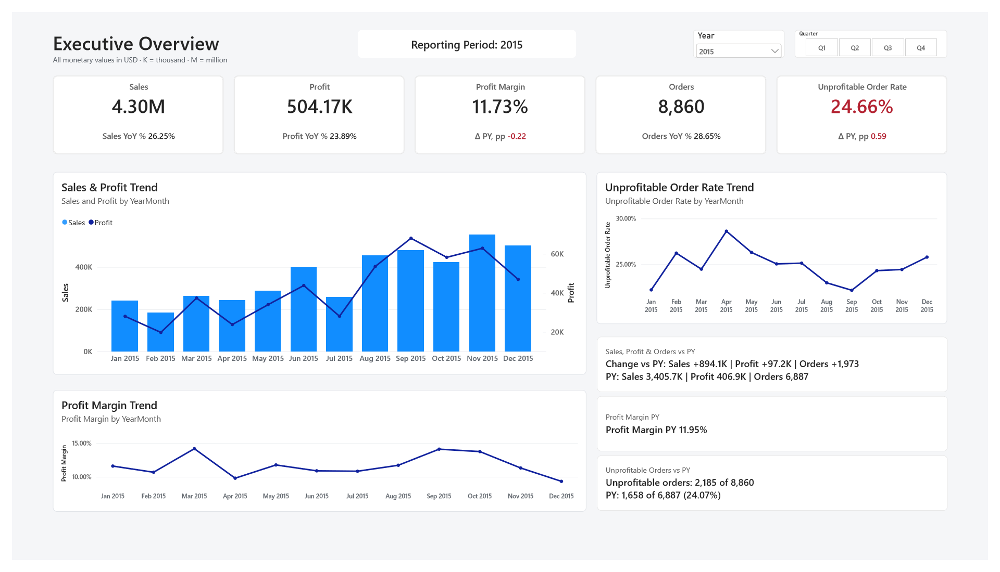
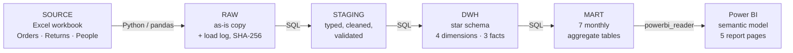
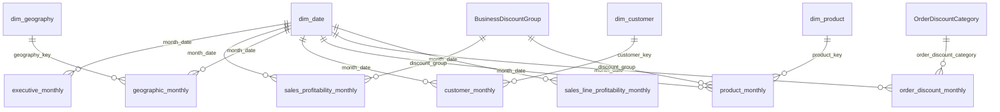
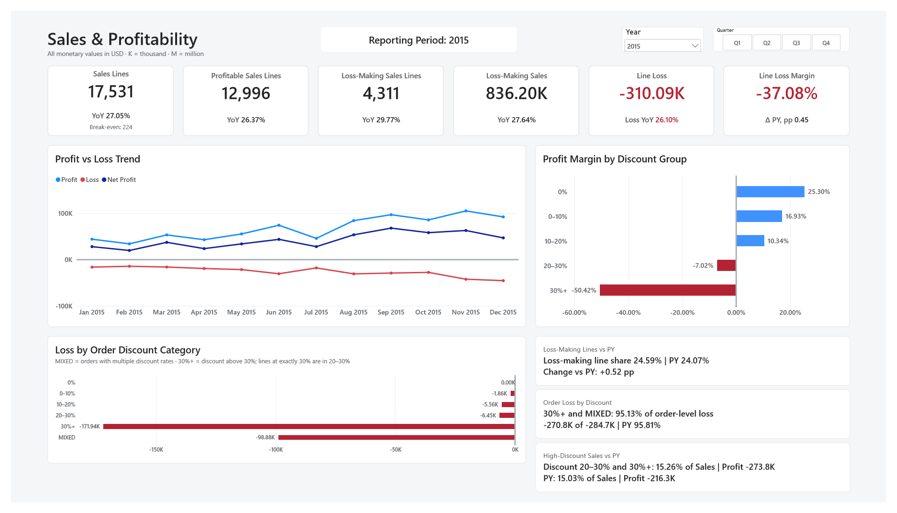
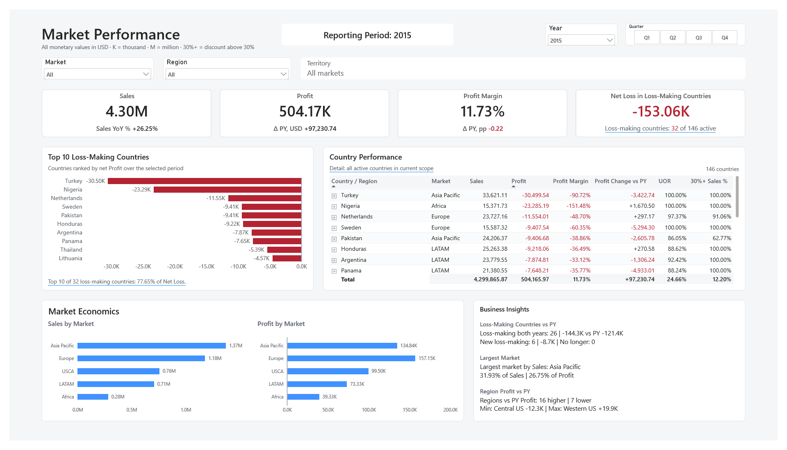
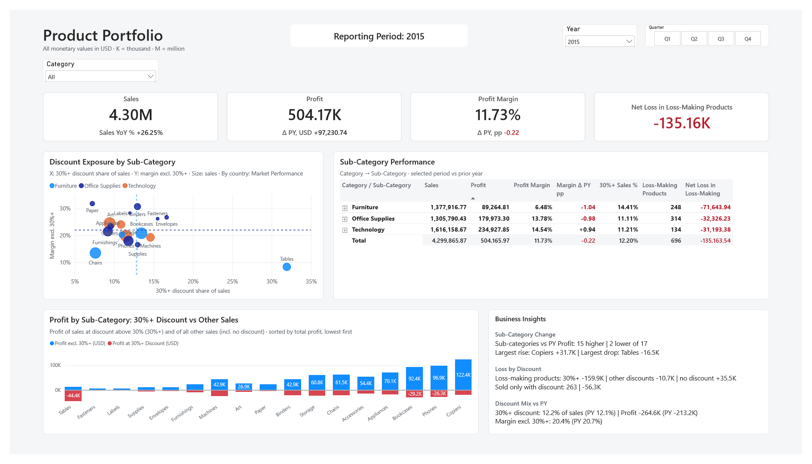
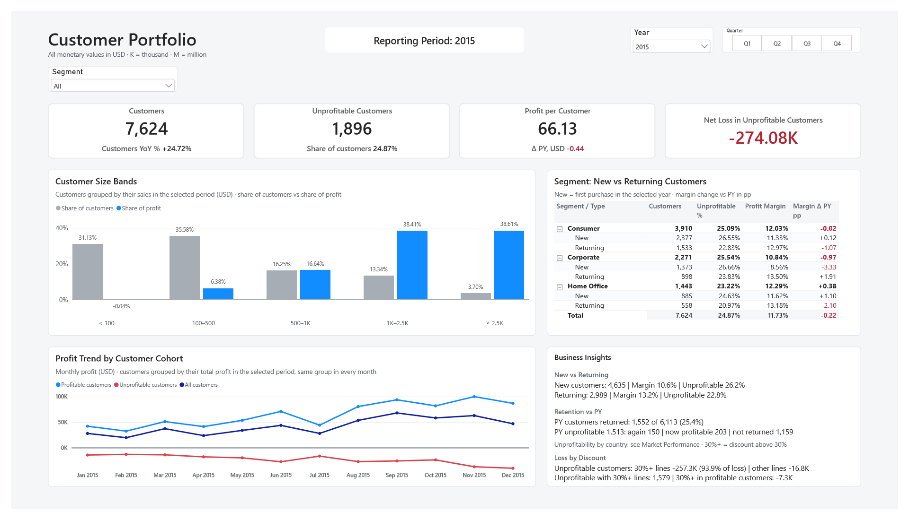

# Global Superstore Analytics

English | [Русский](README.ru.md)


End-to-end business intelligence project: an Excel source is loaded through a layered PostgreSQL warehouse into a five-page Power BI report that shows where a retail business earns and loses profit.



## Business problem

A retail company sells 3,788 products in 165 countries. Sales grow every year (+18.5%, +27.2% and +26.3% in 2013–2015), but the standard sales report does not answer the questions a manager needs for decisions:

- **Where is profit lost?** Which countries, products, customers and discount levels produce loss-making sales.
- **Is growth profitable?** Whether profit and margin grow together with sales.
- **What drives losses?** Whether losses depend on the product, the market or the discount policy.
- **Which customers bring profit?** How profit is split between new and returning, small and large, profitable and unprofitable customers.

The report answers these questions with figures for any selected year, quarter, market or segment, compared with the prior year. Report text states facts and figures only; conclusions are left to the reader.

## Key findings

Values for 2015 unless stated otherwise. Full analysis with prior-year comparisons and limitations: [docs/readme_findings.md](docs/readme_findings.md).

30%+ = discount above 30% (> 0.30); lines at exactly 30% belong to the 20–30% group.

- **Sales and profit.** Sales 4.30M (+26.3% vs 2014), profit 504.2K (+23.9%), profit margin 11.73% (2014: 11.95%).
- **Losses and discounts.** Across 2012–2015, 0 of 29,009 sales lines without a discount are unprofitable. In 2015, 4,311 of 17,531 sales lines (24.6%) are loss-making, with a total loss of −310.1K.
- **30%+ discounts.** Sales lines with a discount above 30% make up 12.2% of sales (524.7K) and −264.6K of profit.
- **Geography.** Across 2012–2015, country (state for the US) explains about 60% of the variance of the indicator "sales line has a 30%+ discount" (epsilon²), product about 3%. 32 of 146 countries with sales in 2015 are loss-making, with a net loss of −153.1K; 10 of them account for 77.6% of it.
- **Unprofitable customers.** 1,896 of 7,624 customers (24.9%) are unprofitable, with a net loss of −274.1K; sales lines with a 30%+ discount account for 93.9% of it.
- **Customer size.** Customers with yearly sales of 1K USD or more are 17.0% of customers and earn 77.0% of profit.

## Dataset

- **Global Superstore 2016** (Tableau sample dataset): 51,290 order lines, January 2012 – December 2015, 24 columns.
- Source file: one Excel workbook with three sheets: Orders (order lines), Returns (returned orders), People (regional managers).
- The dataset is a public training dataset and is likely synthetic; see [Limitations](#limitations).
- **Download:** [global_superstore_2016.xlsx](https://raw.githubusercontent.com/Saurabhgupta301/Global-Superstore-Power-BI-/8dca936fe7bbec3f9010fa664ba8bf1dbaa5e4cb/global_superstore_2016.xlsx) (pinned to a commit of a public GitHub repository). Save it as `data/source/global_superstore_2016.xlsx`.
- **Approved SHA-256:** `5ffb10b2b3c34645251b33b91570e153c272639fa2a179c2f8013185e6a0d482`. The pipeline accepts only a file with this hash. Check it before the run:

  ```powershell
  Get-FileHash data\source\global_superstore_2016.xlsx -Algorithm SHA256
  ```

## Architecture



| Layer | Schema | What happens |
| --- | --- | --- |
| SOURCE → RAW | `raw` | Python reads the workbook and copies all three sheets unchanged; every run is recorded in `raw.load_log` with the file's SHA-256, and a file that was already loaded is skipped. |
| RAW → STAGING | `staging` | SQL casts types, trims and validates values, keeps a link to the RAW row. |
| STAGING → DWH | `dwh` | SQL builds the star schema: dimensions and fact tables with surrogate keys. |
| DWH → MART | `mart` | SQL aggregates facts into monthly tables, one per report topic. |
| MART → Power BI | — | Power BI imports the MART tables and DWH dimensions through a read-only role. |

## Data model

**DWH (star schema):** dimensions `dim_date`, `dim_customer`, `dim_product`, `dim_geography`; facts `fact_order` (order), `fact_order_line` (order line), `fact_return_signal` (returned order).

**MART (7 monthly tables):** `executive_monthly`, `sales_profitability_monthly`, `geographic_monthly`, `customer_monthly`, `product_monthly`, `order_discount_monthly`, `sales_line_profitability_monthly`.

**Power BI model:**



Two disconnected helper tables (`Customer Size Band`, `Customer Type`) group customers inside DAX measures. All measures are stored in one table, grouped into display folders by report page.

The People sheet is loaded into RAW and STAGING only: its regions (Eastern / Western Canada) do not match the Canada region in Orders, so it is not used in DWH, MART or the report.

## Data quality and reconciliation

- Checks are built into the Python loader and every SQL load script: the source file's SHA-256 is checked against the approved hash before anything is written to RAW, the RAW load is checked against the source file, and each next layer checks row counts and totals against the previous one inside its transaction. If any check fails, the stage fails and its changes are rolled back.
- The pipeline prints `PIPELINE SUCCESS` only when every stage, including all reconciliation checks, has passed.
- Key DAX measures were checked against SQL queries on the MART tables.

## Report pages

The report is saved in PBIP format: the model is stored as TMDL and the report as PBIR (JSON), so every change is visible in Git. Each page has Year and Quarter slicers (plus Market / Region, Category or Segment where relevant), KPI cards with prior-year comparison and a block of neutral text facts.

### Executive Overview


Answers: how did the business perform this period compared with the prior year? KPI cards for sales, profit, orders, profit margin and unprofitable order rate; monthly trends of sales and profit, margin and unprofitable order rate.

### Sales & Profitability



Answers: how many sales lines lose money and how is that linked to discounts? Profitable, break-even and loss-making sales lines; profit margin by discount group; loss by order discount category; profit vs loss trend.

### Market Performance



Answers: which markets and countries earn and lose profit? Profit and sales by market; top 10 loss-making countries with their share of the total loss; a Country → Region matrix with margin, unprofitable order rate and share of 30%+ discount sales; a tooltip with order counts.

### Product Portfolio



Answers: which categories and sub-categories lose profit and how much of it comes from 30%+ discounts? Discount exposure by sub-category (scatter); a Category → Sub-Category matrix; profit from 30%+ discount sales vs other sales by sub-category.

### Customer Portfolio



Answers: how is profit distributed across customers? Customers, unprofitable customers, profit per customer; customer size bands (share of customers vs share of profit); profit trend of profitable and unprofitable customer cohorts; new vs returning customers by segment.

Six hidden tooltip pages add details on hover.

## Report design principles

- Text in the report states facts with figures (what changed and by how much), without assessments, causes or recommendations. Conclusions are left to the manager.
- Text cards do not repeat figures already shown in KPI cards and charts on the same page; they add absolute changes, prior-year values and counts.
- Prior-year comparisons need a single selected year with prior-year data; otherwise text measures and labels state that the comparison is unavailable.

## Tech stack

| Area | Tools |
| --- | --- |
| Extraction and load | Python 3.13, pandas, openpyxl, psycopg 3, python-dotenv |
| Storage and transformation | PostgreSQL 17, SQL (schemas `raw`, `staging`, `dwh`, `mart`) |
| Reporting | Power BI Desktop, DAX, PBIP (TMDL + PBIR) |
| Development | Git, PyCharm, DBeaver |

## Repository structure

```text
├── run_pipeline.py        # pipeline entry point: SOURCE → RAW → STAGING → DWH → MART
├── pipeline/              # configuration and Excel → RAW loader
├── sql/
│   ├── 00_setup/          # raw schema
│   ├── 01_raw/            # RAW tables and load log
│   ├── 02_staging/        # STAGING tables and load script
│   ├── 03_dwh/            # dimensions, facts and load scripts
│   ├── 04_mart/           # MART tables and load scripts
│   └── 06_security/       # read-only role for Power BI
├── powerbi/               # Power BI project (PBIP): semantic model (TMDL) and report (PBIR)
├── analysis/              # data profiling and exploratory analysis (notes and read-only scripts)
├── docs/                  # findings, page plans, security and environment documents
├── data/source/           # source Excel workbook (download it, see Dataset)
├── requirements.txt       # pinned Python dependencies
└── .env.example           # configuration keys without values
```

## How to run

### Requirements

- Windows, Python 3.13, PostgreSQL 17 (`psql` in `PATH`), Power BI Desktop with PBIP support.

### Steps

1. **Python environment.**

   ```powershell
   python -m venv venv
   .\venv\Scripts\pip.exe install -r requirements.txt
   ```

2. **Database.** Create a database named `sales_dwh` (the name is checked by the code):

   ```powershell
   createdb -h localhost -U postgres sales_dwh
   ```

3. **Configuration.** Using [.env.example](.env.example), create `.env` (connection and password), `.env.local` (`USE_PROD_ENV=0` or `1`) and `.env.dev` / `.env.prod`. These files are excluded from Git.

4. **Tables.** Run the `*_create_*` scripts in folder and file order. `run_pipeline.py` does not create tables.

   | Order | Scripts |
   | --- | --- |
   | 1 | `sql/00_setup/01_create_raw_schema.sql` |
   | 2 | `sql/01_raw/01`–`04_create_*.sql` (load log, orders, returns, people) |
   | 3 | `sql/02_staging/01`–`04_create_*.sql` |
   | 4 | `sql/03_dwh/01`–`08_create_*.sql` (schema, 4 dimensions, 3 facts) |
   | 5 | `sql/04_mart/01_create_mart_schema.sql`, then `02`, `04`, `06`, `08`, `10`, `12`, `14_create_*.sql` |

   ```powershell
   Get-ChildItem sql -Recurse -Filter '*_create_*.sql' | Sort-Object FullName | ForEach-Object {
       psql -h localhost -U postgres -d sales_dwh -v ON_ERROR_STOP=1 -f $_.FullName
   }
   ```

5. **Pipeline.**

   ```powershell
   .\venv\Scripts\python.exe run_pipeline.py
   ```

   The run ends with a stage summary and `PIPELINE SUCCESS`.

   > **Source check.** The run starts only if the source file's SHA-256 matches the approved hash (see [Dataset](#dataset)). Otherwise it stops at the `Preflight` stage and writes nothing to the database. Each SQL stage receives the `load_id` of the RAW load from the pipeline (session setting `pipeline.load_id`), so run the `*_load_*.sql` scripts through `run_pipeline.py`, not directly with `psql`.

6. **Read-only role for Power BI (optional).** Run `sql/06_security/01_prepare_powerbi_reader.sql` with `psql`, then set the password and enable login manually as described in [docs/powerbi_reader.md](docs/powerbi_reader.md). Check with `02_verify_powerbi_reader.sql`.

7. **Report.** Open `powerbi/GlobalSuperstore.pbip` in Power BI Desktop, enter database credentials when asked (Database authentication, user `powerbi_reader`) and select **Refresh**. All data sources point to `localhost:5432/sales_dwh`.

## Security

- Power BI connects as `powerbi_reader`: it can read the 11 tables used by the model and cannot change tables or schema objects. Audit, granted privileges and verification steps: [docs/powerbi_reader.md](docs/powerbi_reader.md).
- Passwords and connection settings are stored only in local `.env` files, which are excluded from Git. Configuration errors never print setting values.

## Limitations

- **One database, no DEV / PROD separation.** Both ETL profiles point to the same local database `sales_dwh`, and the ETL connects as `postgres`. A plan for separate environments: [docs/dev_prod_plan.ru.md](docs/dev_prod_plan.ru.md) (in Russian; not implemented).
- **One approved source file.** The pipeline accepts only the workbook with the approved SHA-256 (see [Dataset](#dataset)). Another version of the dataset requires changing `APPROVED_SOURCE_SHA256` in `run_pipeline.py` and passing all reconciliation checks again.
- **Fixed data source in Power BI.** All 11 sources use `localhost:5432/sales_dwh`; there are no Server / Database parameters.
- **No CI or separate automated tests.** Checks are built into the Python loader and SQL scripts.
- **Dataset.** A training dataset, likely synthetic, ending in 2015. It has no inventory, price list or product lifecycle data, so the reasons for discounts cannot be determined.
- **Model scope.** Quantity is not in the MART tables; the People sheet is not used in the report; the customer and product marts have no geography, so customer × country and product × country links are documented as analysis results in [docs/readme_findings.md](docs/readme_findings.md), not shown in the report.
- **Customer identity.** The same buyer has a separate Customer ID in each country, so a "new" customer may be a known buyer in another country.

## Further documentation

| Document | Content |
| --- | --- |
| [docs/readme_findings.md](docs/readme_findings.md) | Key findings with prior-year comparisons |
| [docs/product_portfolio_plan.ru.md](docs/product_portfolio_plan.ru.md) | Product Portfolio page: analysis, decisions, control values (in Russian) |
| [docs/customer_portfolio_plan.ru.md](docs/customer_portfolio_plan.ru.md) | Customer Portfolio page: analysis, decisions, control values (in Russian) |
| [docs/powerbi_reader.md](docs/powerbi_reader.md) | Read-only Power BI role: audit, implementation, verification |
| [docs/dev_prod_plan.ru.md](docs/dev_prod_plan.ru.md) | Plan for DEV / PROD separation (in Russian) |

## Author

**Radik** — data analyst.

- GitHub: [Rad99-max](https://github.com/Rad99-max)

## License

Code: MIT (see [LICENSE](LICENSE)). The license does not cover the Global Superstore dataset; it belongs to its original authors.
