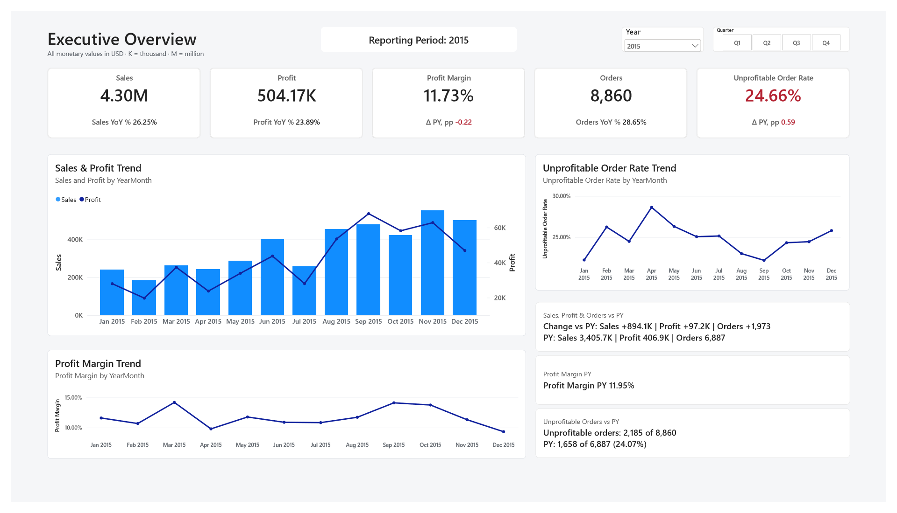
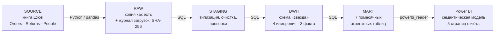
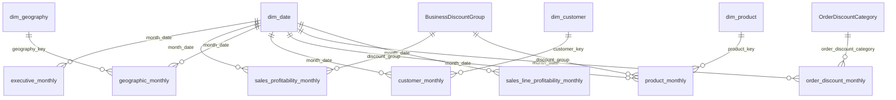
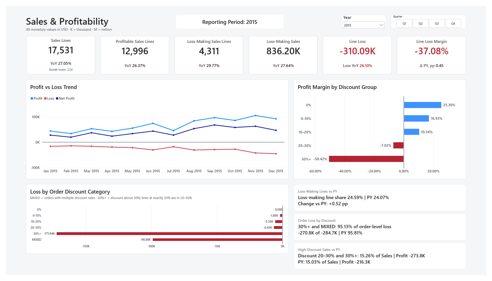
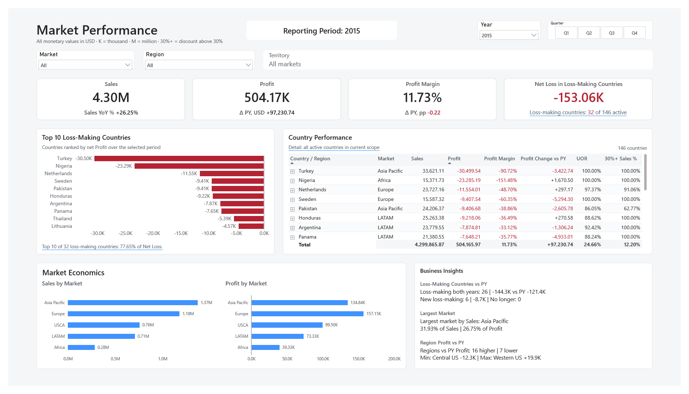
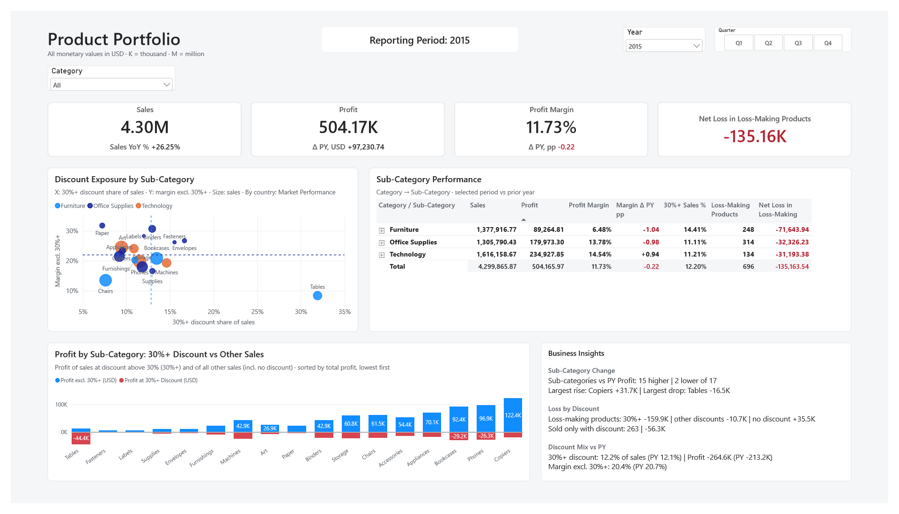
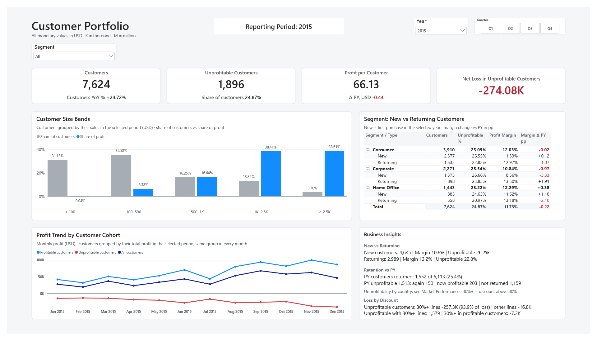

# Global Superstore Analytics

[English](README.md) | Русский


Сквозной проект бизнес-аналитики: данные из Excel проходят через многослойное хранилище PostgreSQL в пятистраничный отчёт Power BI, который показывает, где розничный бизнес зарабатывает и теряет прибыль.



## Бизнес-задача

Розничная компания продаёт 3 788 товаров в 165 странах. Продажи растут каждый год (+18,5%, +27,2% и +26,3% в 2013–2015 годах), но стандартный отчёт о продажах не отвечает на вопросы, которые нужны руководителю для решений:

- **Где теряется прибыль?** Какие страны, товары, клиенты и уровни скидки дают убыточные продажи.
- **Прибылен ли рост?** Растут ли прибыль и маржа вместе с продажами.
- **Что определяет убытки?** Зависят ли убытки от товара, рынка или скидочной политики.
- **Какие клиенты приносят прибыль?** Как прибыль распределяется между новыми и возвращающимися, мелкими и крупными, прибыльными и убыточными клиентами.

Отчёт отвечает на эти вопросы цифрами за любой выбранный год, квартал, рынок или сегмент в сравнении с прошлым годом. Текст в отчёте содержит только факты и цифры; выводы делает читатель.

## Основные выводы

Значения за 2015 год, если не указано иное. Полный анализ со сравнением с прошлым годом и ограничениями: [docs/readme_findings.ru.md](docs/readme_findings.ru.md).

30%+ — скидка больше 30% (> 0,30); строки ровно с 30% входят в группу 20–30%.

- **Продажи и прибыль.** Продажи 4,30M (+26,3% к 2014 году), прибыль 504,2K (+23,9%), маржа 11,73% (2014: 11,95%).
- **Убытки и скидки.** За 2012–2015 годы ни одна строка продаж без скидки не убыточна (0 из 29 009 строк). В 2015 году убыточны 4 311 из 17 531 строки продаж (24,6%), их суммарный убыток −310,1K.
- **Скидка 30%+.** На строки продаж со скидкой больше 30% приходится 12,2% продаж (524,7K) и −264,6K прибыли.
- **География.** За 2012–2015 годы страна (для США — штат) объясняет около 60% различий в признаке «строка продаж со скидкой 30%+» (epsilon²), товар — около 3%. Убыточны 32 из 146 стран с продажами в 2015 году, их чистый убыток −153,1K; 10 из них дают 77,6% этого убытка.
- **Убыточные клиенты.** Убыточны 1 896 из 7 624 клиентов (24,9%), их чистый убыток −274,1K; 93,9% этого убытка дают строки продаж со скидкой 30%+.
- **Размер клиента.** Клиенты с продажами за год от 1K USD — это 17,0% клиентов и 77,0% прибыли.

## Данные

- **Global Superstore 2016** (учебный датасет Tableau): 51 290 строк заказов, январь 2012 – декабрь 2015, 24 колонки.
- Исходный файл: одна книга Excel с тремя листами: Orders (строки заказов), Returns (возвращённые заказы), People (региональные менеджеры).
- Это открытый учебный датасет, вероятно, синтетический; см. [Ограничения](#ограничения).
- **Скачать:** [global_superstore_2016.xlsx](https://raw.githubusercontent.com/Saurabhgupta301/Global-Superstore-Power-BI-/8dca936fe7bbec3f9010fa664ba8bf1dbaa5e4cb/global_superstore_2016.xlsx) (ссылка закреплена на коммит открытого репозитория GitHub). Сохраните файл как `data/source/global_superstore_2016.xlsx`.
- **Утверждённый SHA-256:** `5ffb10b2b3c34645251b33b91570e153c272639fa2a179c2f8013185e6a0d482`. Конвейер принимает только файл с этим хешем. Проверьте его перед запуском:

  ```powershell
  Get-FileHash data\source\global_superstore_2016.xlsx -Algorithm SHA256
  ```

## Архитектура



| Слой | Схема | Что происходит |
| --- | --- | --- |
| SOURCE → RAW | `raw` | Python читает книгу и копирует все три листа без изменений; каждый запуск записывается в `raw.load_log` с SHA-256 файла, уже загруженный файл пропускается. |
| RAW → STAGING | `staging` | SQL приводит типы, обрезает пробелы и проверяет значения, сохраняет ссылку на строку RAW. |
| STAGING → DWH | `dwh` | SQL строит схему «звезда»: измерения и таблицы фактов с суррогатными ключами. |
| DWH → MART | `mart` | SQL агрегирует факты в помесячные таблицы, по одной на тему отчёта. |
| MART → Power BI | — | Power BI импортирует таблицы MART и измерения DWH через роль только для чтения. |

## Модель данных

**DWH (схема «звезда»):** измерения `dim_date`, `dim_customer`, `dim_product`, `dim_geography`; факты `fact_order` (заказ), `fact_order_line` (строка заказа), `fact_return_signal` (возвращённый заказ).

**MART (7 помесячных таблиц):** `executive_monthly`, `sales_profitability_monthly`, `geographic_monthly`, `customer_monthly`, `product_monthly`, `order_discount_monthly`, `sales_line_profitability_monthly`.

**Модель Power BI:**



Две вспомогательные таблицы без связей (`Customer Size Band`, `Customer Type`) группируют клиентов внутри мер DAX. Все меры хранятся в одной таблице и разложены по папкам отображения (display folders) по страницам отчёта.

Лист People загружается только в RAW и STAGING: его регионы (Eastern / Western Canada) не совпадают с регионом Canada в Orders, поэтому он не используется в DWH, MART и отчёте.

## Качество данных и сверка

- Проверки встроены в загрузчик на Python и в каждый SQL-скрипт загрузки: до записи в RAW SHA-256 исходного файла сверяется с утверждённым хешем, загрузка RAW сверяется с исходным файлом, а каждый следующий слой внутри своей транзакции сверяет число строк и итоги с предыдущим. Если проверка не проходит, этап падает и его изменения откатываются.
- Конвейер печатает `PIPELINE SUCCESS`, только если все этапы, включая все сверки, пройдены.
- Ключевые меры DAX сверены с SQL-запросами к таблицам MART.

## Страницы отчёта

Отчёт сохранён в формате PBIP: модель хранится в TMDL, отчёт — в PBIR (JSON), поэтому каждое изменение видно в Git. На каждой странице есть слайсеры Year и Quarter (и, где нужно, Market / Region, Category или Segment), KPI-карточки со сравнением с прошлым годом и блок нейтральных текстовых фактов.

### Executive Overview


Отвечает на вопрос: как бизнес отработал период по сравнению с прошлым годом? KPI-карточки продаж, прибыли, заказов, маржи и доли убыточных заказов; помесячные тренды продаж и прибыли, маржи и доли убыточных заказов.

### Sales & Profitability



Отвечает на вопрос: сколько строк продаж убыточны и как это связано со скидками? Прибыльные, безубыточные и убыточные строки продаж; маржа по группам скидок; убыток по категориям скидки заказа; тренд прибыли и убытка.

### Market Performance



Отвечает на вопрос: какие рынки и страны зарабатывают и теряют прибыль? Прибыль и продажи по рынкам; 10 самых убыточных стран и их доля в общем убытке; матрица Country → Region с маржой, долей убыточных заказов и долей продаж со скидкой 30%+; всплывающая подсказка (tooltip) с числом заказов.

### Product Portfolio



Отвечает на вопрос: какие категории и подкатегории теряют прибыль и какая её часть приходится на скидку 30%+? Подверженность скидке по подкатегориям (точечная диаграмма); матрица Category → Sub-Category; прибыль от продаж со скидкой 30%+ и от прочих продаж по подкатегориям.

### Customer Portfolio



Отвечает на вопрос: как прибыль распределяется по клиентам? Клиенты, убыточные клиенты, прибыль на клиента; группы клиентов по размеру (доля клиентов и доля прибыли); тренд прибыли когорт прибыльных и убыточных клиентов; новые и возвращающиеся клиенты по сегментам.

Шесть скрытых tooltip-страниц показывают подробности при наведении.

## Принципы оформления отчёта

- Текст в отчёте содержит факты с цифрами (что и на сколько изменилось), без оценок, причин и рекомендаций. Выводы делает руководитель.
- Текстовые карточки не повторяют цифры, уже показанные в KPI-карточках и графиках той же страницы; они добавляют абсолютные изменения, значения прошлого года и количества.
- Для сравнения с прошлым годом нужен один выбранный год, у которого есть данные прошлого года; иначе текстовые меры и подписи сообщают, что сравнение недоступно.

## Технологии

| Область | Инструменты |
| --- | --- |
| Извлечение и загрузка | Python 3.13, pandas, openpyxl, psycopg 3, python-dotenv |
| Хранение и преобразование | PostgreSQL 17, SQL (схемы `raw`, `staging`, `dwh`, `mart`) |
| Отчётность | Power BI Desktop, DAX, PBIP (TMDL + PBIR) |
| Разработка | Git, PyCharm, DBeaver |

## Структура репозитория

```text
├── run_pipeline.py        # точка входа конвейера: SOURCE → RAW → STAGING → DWH → MART
├── pipeline/              # конфигурация и загрузчик Excel → RAW
├── sql/
│   ├── 00_setup/          # схема raw
│   ├── 01_raw/            # таблицы RAW и журнал загрузок
│   ├── 02_staging/        # таблицы STAGING и скрипт загрузки
│   ├── 03_dwh/            # измерения, факты и скрипты загрузки
│   ├── 04_mart/           # таблицы MART и скрипты загрузки
│   └── 06_security/       # роль только для чтения для Power BI
├── powerbi/               # проект Power BI (PBIP): семантическая модель (TMDL) и отчёт (PBIR)
├── analysis/              # профилирование данных и исследовательский анализ (заметки и скрипты только для чтения)
├── docs/                  # выводы, планы страниц, документы по безопасности и средам
├── data/source/           # исходная книга Excel (скачать, см. «Данные»)
├── requirements.txt       # зафиксированные версии зависимостей Python
└── .env.example           # ключи конфигурации без значений
```

## Как запустить

### Требования

- Windows, Python 3.13, PostgreSQL 17 (`psql` в `PATH`), Power BI Desktop с поддержкой PBIP.

### Шаги

1. **Окружение Python.**

   ```powershell
   python -m venv venv
   .\venv\Scripts\pip.exe install -r requirements.txt
   ```

2. **База данных.** Создайте базу с именем `sales_dwh` (имя проверяется кодом):

   ```powershell
   createdb -h localhost -U postgres sales_dwh
   ```

3. **Конфигурация.** По образцу [.env.example](.env.example) создайте `.env` (подключение и пароль), `.env.local` (`USE_PROD_ENV=0` или `1`) и `.env.dev` / `.env.prod`. Эти файлы исключены из Git.

4. **Таблицы.** Выполните скрипты `*_create_*` в порядке папок и файлов. `run_pipeline.py` таблицы не создаёт.

   | Порядок | Скрипты |
   | --- | --- |
   | 1 | `sql/00_setup/01_create_raw_schema.sql` |
   | 2 | `sql/01_raw/01`–`04_create_*.sql` (журнал загрузок, orders, returns, people) |
   | 3 | `sql/02_staging/01`–`04_create_*.sql` |
   | 4 | `sql/03_dwh/01`–`08_create_*.sql` (схема, 4 измерения, 3 факта) |
   | 5 | `sql/04_mart/01_create_mart_schema.sql`, затем `02`, `04`, `06`, `08`, `10`, `12`, `14_create_*.sql` |

   ```powershell
   Get-ChildItem sql -Recurse -Filter '*_create_*.sql' | Sort-Object FullName | ForEach-Object {
       psql -h localhost -U postgres -d sales_dwh -v ON_ERROR_STOP=1 -f $_.FullName
   }
   ```

5. **Конвейер.**

   ```powershell
   .\venv\Scripts\python.exe run_pipeline.py
   ```

   Запуск заканчивается сводкой по этапам и строкой `PIPELINE SUCCESS`.

   > **Проверка источника.** Запуск начинается, только если SHA-256 исходного файла совпадает с утверждённым хешем (см. [Данные](#данные)). Иначе он останавливается на этапе `Preflight` и ничего не пишет в базу. Каждый SQL-этап получает `load_id` загрузки RAW от конвейера (настройка сеанса `pipeline.load_id`), поэтому скрипты `*_load_*.sql` запускайте через `run_pipeline.py`, а не напрямую через `psql`.

6. **Роль только для чтения для Power BI (необязательно).** Выполните `sql/06_security/01_prepare_powerbi_reader.sql` через `psql`, затем задайте пароль и разрешите вход вручную, как описано в [docs/powerbi_reader.ru.md](docs/powerbi_reader.ru.md). Проверка — `02_verify_powerbi_reader.sql`.

7. **Отчёт.** Откройте `powerbi/GlobalSuperstore.pbip` в Power BI Desktop, по запросу введите учётные данные базы (Database authentication, пользователь `powerbi_reader`) и нажмите **Refresh**. Все источники данных указывают на `localhost:5432/sales_dwh`.

## Безопасность

- Power BI подключается под `powerbi_reader`: роль читает 11 таблиц, используемых моделью, и не может изменять таблицы и объекты схемы. Аудит, выданные права и порядок проверки: [docs/powerbi_reader.ru.md](docs/powerbi_reader.ru.md).
- Пароли и настройки подключения хранятся только в локальных файлах `.env`, исключённых из Git. Ошибки конфигурации никогда не выводят значения настроек.

## Ограничения

- **Одна база, нет разделения DEV / PROD.** Оба ETL-профиля указывают на одну локальную базу `sales_dwh`, ETL подключается под `postgres`. План раздельных сред: [docs/dev_prod_plan.ru.md](docs/dev_prod_plan.ru.md) (не реализован).
- **Один утверждённый исходный файл.** Конвейер принимает только книгу с утверждённым SHA-256 (см. [Данные](#данные)). Для другой версии датасета нужно заменить `APPROVED_SOURCE_SHA256` в `run_pipeline.py` и заново пройти все сверки.
- **Фиксированный источник данных в Power BI.** Все 11 источников используют `localhost:5432/sales_dwh`; параметров Server / Database нет.
- **Нет CI и отдельных автотестов.** Проверки встроены в загрузчик на Python и SQL-скрипты.
- **Датасет.** Учебный, вероятно, синтетический, заканчивается 2015 годом. В нём нет остатков, прайс-листов и данных о жизненном цикле товара, поэтому причины скидок установить нельзя.
- **Охват модели.** Quantity в таблицах MART нет; лист People в отчёте не используется; в клиентской и продуктовой витринах нет географии, поэтому связи «клиент × страна» и «товар × страна» описаны как результаты анализа в [docs/readme_findings.ru.md](docs/readme_findings.ru.md), а в отчёте не показаны.
- **Идентификация клиентов.** У одного и того же покупателя в каждой стране свой Customer ID, поэтому «новым» может оказаться известный покупатель из другой страны.

## Дополнительная документация

| Документ | Содержание |
| --- | --- |
| [docs/readme_findings.ru.md](docs/readme_findings.ru.md) | Основные выводы со сравнением с прошлым годом |
| [docs/product_portfolio_plan.ru.md](docs/product_portfolio_plan.ru.md) | Страница Product Portfolio: анализ, решения, контрольные значения (на русском) |
| [docs/customer_portfolio_plan.ru.md](docs/customer_portfolio_plan.ru.md) | Страница Customer Portfolio: анализ, решения, контрольные значения (на русском) |
| [docs/powerbi_reader.ru.md](docs/powerbi_reader.ru.md) | Роль Power BI только для чтения: аудит, внедрение, проверка |
| [docs/dev_prod_plan.ru.md](docs/dev_prod_plan.ru.md) | План разделения DEV / PROD (на русском) |

## Автор

**Radik** — аналитик данных.

- GitHub: [Rad99-max](https://github.com/Rad99-max)

## Лицензия

Код: MIT (см. [LICENSE](LICENSE)). Лицензия не распространяется на датасет Global Superstore; он принадлежит его первоначальным авторам.
